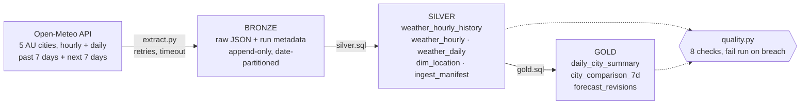

# Open-Meteo Medallion Pipeline

An end-to-end weather data pipeline built on the [Open-Meteo Forecast API](https://open-meteo.com/en/docs) using a **bronze → silver → gold** Medallion architecture. Everything runs locally with Python and DuckDB. There is no server, no API key and no cloud account.

## Quickstart

Requires [uv](https://docs.astral.sh/uv/) (it installs a suitable Python automatically).

```bash
uv sync                          # install dependencies
uv run python -m pipeline run    # extract -> silver -> gold -> data quality -> sample output
uv run pytest -q                 # offline tests (no network)
```

With `make`: `make setup`, `make run`, `make test`. You can also run each stage on its own: `python -m pipeline extract | transform | dq | query`.

Output: raw files in `data/bronze/`, warehouse in `data/warehouse.duckdb`. To explore the results:

```bash
uv run python -c "import duckdb; duckdb.connect('data/warehouse.duckdb').sql('SELECT * FROM gold.city_comparison_7d').show()"
```

## Architecture



| Layer | Table | Grain | What it does |
|---|---|---|---|
| Bronze | `data/bronze/open_meteo/ingest_date=*/<city>_<ts>_<run>.json` | one file per city per run | The exact API response wrapped with `run_id`, `ingested_at`, `request_url` and `http_status`. Never modified, so silver can always be rebuilt without calling the API again. |
| Silver | `ingest_manifest` | one row per bronze file | Lineage and audit of each request. |
| Silver | `weather_hourly_history` | city × hour × run | API arrays flattened to typed rows, keeping every version. |
| Silver | `weather_hourly` | city × hour | Deduplicated: the latest ingestion wins. `is_forecast` flags future hours. |
| Silver | `weather_daily` | city × day | Daily aggregates from the API, deduplicated the same way. |
| Silver | `dim_location` | city | Loaded from `config/locations.yaml`. |
| Gold | `daily_city_summary` | city × day | Min/max/avg temperature, humidity, rain, wind, UV, plus `is_hot_day`, `is_wet_day` and `is_forecast` flags. |
| Gold | `city_comparison_7d` | city | Last 7 observed days compared across cities, ranked by warmth. |
| Gold | `forecast_revisions` | city × hour | How much the forecast for a given hour changed across pipeline runs. |

## Design decisions

- **DuckDB + files:** serverless, columnar and reads JSON natively, so the whole lakehouse runs on a laptop. The same SQL ports to Snowflake, BigQuery or Databricks.
- **Raw JSON in bronze:** replayable and auditable. Changing silver logic means rebuilding from bronze, not re-calling the API.
- **Overlapping windows (`past_days=7`):** each run re-fetches hours already seen. Silver deduplicates on `(location_id, ts_utc)`, keeping the latest `ingested_at`, so reruns are **idempotent** and forecast revisions can be measured.
- **Full rebuild of silver/gold:** the data is small, so a rebuild is simpler and always consistent. At scale this becomes an incremental `MERGE` partitioned by date.
- **UTC everywhere:** requests use `timezone=UTC`.
- **Failure handling:** HTTP retries with exponential backoff on 429/5xx, plus a 30 s timeout. If any city fails, the run fails rather than loading partial data silently.
- **Data quality gates:** primary-key uniqueness, not-null keys, physical ranges (temperature, humidity, precipitation), every configured location present, and bronze row counts reconciled to silver.
- **Config-driven:** adding a city or variable is a one-line YAML change.

## Tests

`tests/test_pipeline.py` uses synthetic API responses, so the tests never hit the network. It checks that request parameters are built correctly, that deduplication keeps the latest ingestion, that reruns are idempotent, that forecast revisions are calculated correctly, and that DQ fails on bad data.

## What I'd add for production

A scheduler (Airflow/Dagster) running hourly; object storage (S3/ADLS) for bronze; Delta or Iceberg tables with incremental merges; Archive API backfill; alerting on DQ failures; CI running the tests; a Dockerfile.

## AI usage

See [`docs/ai-usage.md`](docs/ai-usage.md) and the screenshots in `docs/ai-evidence/`.
